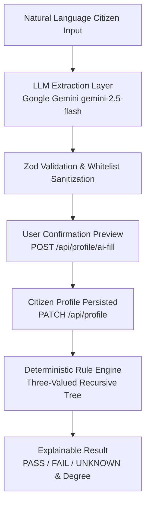

# Scheme Setu - Backend API, Eligibility Rule Engine & AI Profile Filling

Production-grade Node.js/Express backend, passwordless authentication, role-based access control, **deterministic eligibility rule engine**, and **AI-assisted citizen profile filling** built for **Scheme Setu (SIH 2026)**.

---

## Architectural Principles & Separation of Concerns

Scheme Setu enforces a strict boundary between **AI Natural Language Extraction** and **Deterministic Scheme Eligibility Evaluation**:



### Critical Rules:
1. **Extraction Layer Only**: The LLM parses natural language text into candidate structured attributes. It **never** evaluates eligibility, modifies government rules, invents missing facts, or makes final decisions.
2. **Deterministic Evaluation**: Scheme eligibility evaluation is 100% deterministic, recursive, and explainable, operating without any LLM involvement.
3. **Three-Valued Logic**: Missing citizen attributes yield `unknown` status rather than automatic failure, allowing the engine to calculate precise missing information and request targeted follow-ups.

---

## Technical Features & Stack

- **Core Framework & Environment**: Node.js (ES Modules), Express.js
- **Database & ODM**: MongoDB with Mongoose ODM
- **AI Profile Extraction**:
  - Natural language parsing via Google Gemini API (`gemini-2.5-flash`) with deterministic fallback.
  - Strict field whitelisting (`Personal`, `Economic`, `Location`, `Household`, `SpecialConditions`).
  - Contradiction/conflict detection (e.g. conflicting age declarations).
  - Returns intermediate extraction preview for citizen confirmation before saving.
- **Deterministic Rule Engine**:
  - Recursive `AND`, `OR`, `NOT` tree evaluation.
  - Three-valued logic (`passed`, `failed`, `unknown`).
  - Eligibility degrees:
    - `fully_eligible` (100% criteria met)
    - `partially_eligible` (partial branch criteria met)
    - `ineligible` (mandatory criteria explicitly failed)
    - `needs_more_info` (required attributes missing)
  - Full evaluation tree trace & missing fields array.
- **Rule Set Versioning & Audit Logging**:
  - Version-controlled `RuleSet` documents.
  - Immutable audit logs in `EligibilityCheck` capturing user input snapshots and result trees.
- **Passwordless Authentication**: 6-digit OTP sent to email via Nodemailer.
- **Direct Google OAuth**: Google OAuth 2.0 verification via `google-auth-library` (`verifyIdToken`).
- **Security & Rate Limiting**:
  - Access (15m) & Refresh (7d) tokens delivered via HTTP-only cookies.
  - SHA-256 hashed refresh token & OTP storage.
  - Sliding window rate limiting via `@upstash/ratelimit` & Upstash Redis.
  - Request payload validation using Zod.
- **Automated In-Memory Testing**: `MongoMemoryServer` integration test setup running under Jest (7 suites, 29 passing tests).

---

## Project Structure

```
server/src/
├── config/
│   ├── connectDB.js         # MongoDB database connection setup
│   ├── cloudinary.js        # Cloudinary SDK setup
│   ├── googleAuth.js        # Google OAuth2 client initialization
│   └── upstash.js           # Upstash Redis client & sliding window limiters
├── data/
│   └── myscheme.json        # Government schemes & rule trees dataset
├── scripts/
│   └── seedSchemes.js       # Database seeder for schemes & rule sets
├── models/
│   ├── User.js              # User schema with profile fields, OTP fields, RBAC, & metadata
│   ├── Scheme.js            # Scheme metadata schema
│   ├── RuleSet.js           # Versioned RuleSet schema
│   └── EligibilityCheck.js  # Audit check log snapshot schema
├── services/
│   ├── ai/
│   │   ├── cerebrasProvider.js        # Isolated Cerebras LLM REST client
│   │   └── profileExtractionService.js# AI profile extraction, Zod validation & conflict detection
│   └── eligibility/
│       ├── fieldWhitelist.js    # Allowed citizen fields & category lookup
│       ├── operators.js         # Pure comparison operators
│       ├── conditionEvaluator.js# Leaf condition 3-valued evaluator
│       ├── ruleEngine.js        # Recursive AND/OR/NOT tree evaluator
│       └── eligibilityService.js# Main evaluation service wrapper
├── emails/
│   ├── mailer.js            # Nodemailer transporter helper
│   └── otpEmail.js          # HTML template for 6-digit OTP delivery
├── utils/
│   ├── tokenUtils.js        # Access & Refresh token generators (HTTP-only cookies)
│   └── hashUtils.js         # SHA-256 token hashing utility
├── middlewares/
│   ├── authMiddleware.js    # protect & authorize(...roles) route guards
│   ├── uploadMiddleware.js  # Multer memory storage & Cloudinary uploader
│   ├── validateMiddleware.js# Reusable Zod validation middleware
│   ├── rateLimiter.js       # Upstash sliding window rate limiting middleware
│   └── errorMiddleware.js   # Global Express error handler
├── validations/
│   ├── authValidation.js    # Zod schemas for auth payloads
│   ├── profileValidation.js # Zod schemas for extracted profile candidate data & updates
│   ├── ruleValidation.js    # Recursive Zod schema for rule trees
│   ├── schemeValidation.js  # Zod schema for schemes and rulesets
│   └── eligibilityValidation.js # Zod schema for eligibility inputs
├── controllers/
│   ├── authController.js    # Auth & user controllers
│   ├── profileController.js # AI profile fill preview & profile updates
│   ├── schemeController.js  # Scheme & RuleSet management
│   └── eligibilityController.js # Eligibility check & audit history
├── routes/
│   ├── authRoutes.js        # Mounted at /api/auth
│   ├── profileRoutes.js     # Mounted at /api/profile
│   ├── schemeRoutes.js      # Mounted at /api/schemes
│   └── eligibilityRoutes.js # Mounted at /api/eligibility
├── app.js                   # Application middleware & routing setup
└── server.js                # Application entry point
```

---

## Getting Started & Database Seeding

### 1. Installation
```bash
cd server
npm install
```

### 2. Environment Setup
Copy `.env.example` to `.env` and fill in your keys:
```env
PORT=5000
MONGODB_URI=mongodb://localhost:27017/scheme-setu
CLIENT_URL=http://localhost:5173

# JWT Secrets
JWT_ACCESS_SECRET=your_access_secret_key
JWT_REFRESH_SECRET=your_refresh_secret_key

# Nodemailer Credentials
EMAIL_USER=your_email@gmail.com
EMAIL_APP_PASSWORD=your_gmail_app_password

# Cerebras LLM
CEREBRAS_API_KEY=your_cerebras_api_key
CEREBRAS_MODEL=gpt-oss-120b

# Upstash Redis
UPSTASH_REDIS_REST_URL=https://your-upstash-instance.upstash.io
UPSTASH_REDIS_REST_TOKEN=your_upstash_rest_token
```

### 3. Database Seeding
To populate MongoDB with government schemes and active RuleSets defined in `src/data/myscheme.json`:
```bash
npm run seed
```

### 4. Running Dev Server
```bash
npm run dev
```

---

## API Endpoints Reference

### AI Profile Filling & Profile Management
| Method | Endpoint | Protection | Rate Limit | Description |
| :--- | :--- | :--- | :--- | :--- |
| `POST` | `/api/profile/ai-fill` | Protected | 60 req / 1 m | Extract candidate facts from text (preview only, no DB mutation) |
| `PATCH` | `/api/profile` | Protected | 60 req / 1 m | Confirm and persist profile updates to user document |

### Authentication & User Profiles
| Method | Endpoint | Protection | Rate Limit | Description |
| :--- | :--- | :--- | :--- | :--- |
| `POST` | `/api/auth/send-otp` | Public | 10 req / 15 m | Send 6-digit OTP code to email |
| `POST` | `/api/auth/verify-otp` | Public | 10 req / 15 m | Verify OTP code and issue JWT session cookies |
| `POST` | `/api/auth/google` | Public | 15 req / 15 m | Direct login via Google OAuth ID token |
| `POST` | `/api/auth/refresh` | Public | 20 req / 5 m | Refresh access token |
| `POST` | `/api/auth/logout` | Public/Protected | 20 req / 5 m | Revoke refresh token and clear cookies |
| `GET` | `/api/auth/me` | Protected | 60 req / 1 m | Get user profile and role metadata |
| `PUT` | `/api/auth/update-me` | Protected | 60 req / 1 m | Update profile details and avatar image |

### Schemes & RuleSet Management
| Method | Endpoint | Protection | Rate Limit | Description |
| :--- | :--- | :--- | :--- | :--- |
| `GET` | `/api/schemes` | Public | 60 req / 1 m | List all published schemes |
| `GET` | `/api/schemes/:slug` | Public | 60 req / 1 m | Get scheme details by slug |
| `POST` | `/api/schemes` | Admin Only | 60 req / 1 m | Create a new scheme |
| `POST` | `/api/schemes/:slug/rulesets` | Admin Only | 60 req / 1 m | Add a new versioned RuleSet to a scheme |
| `PATCH` | `/api/schemes/:slug/rulesets/:version/activate` | Admin Only | 60 req / 1 m | Activate a specific RuleSet version |

### Eligibility Engine
| Method | Endpoint | Protection | Rate Limit | Description |
| :--- | :--- | :--- | :--- | :--- |
| `POST` | `/api/eligibility/check/:schemeSlug` | Public / Optional Auth | 60 req / 1 m | Evaluate citizen facts against active scheme RuleSet |
| `GET` | `/api/eligibility/history` | Protected | 60 req / 1 m | Retrieve user historical audit check log |

---

## Running Unit & Integration Tests

All test suites use `MongoMemoryServer` to run in-memory without requiring an active external MongoDB instance:

```bash
cd server
npm test
```
